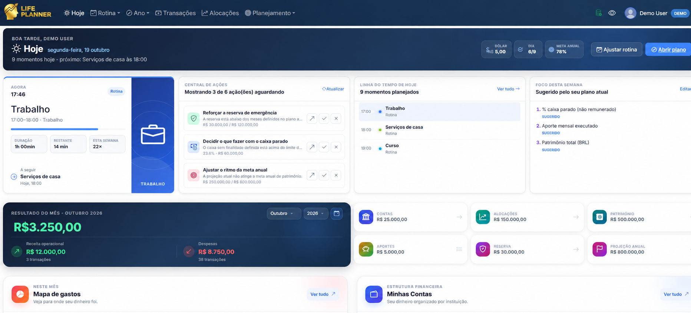
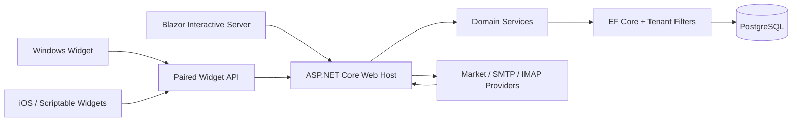

# AppLifePlanner

[](https://github.com/johnnysb160/AppLifePlanner-Showcase/actions/workflows/ci.yml)


AppLifePlanner is a personal operating system for finances, investments, routines, annual planning, and daily execution. It turns financial and planning data into a focused answer to three questions: **what matters now, what this week serves, and whether the year is moving toward its goals**.

> This repository is a sanitized public snapshot of a private production project. It contains no production database, credentials, personal transactions, or private operational history. The public demo uses a read-only synthetic tenant.

## Product snapshot



## Why this project exists

Most personal-finance applications stop at reporting, while planning tools require the user to manually repeat information that already exists elsewhere. AppLifePlanner connects both sides: canonical financial facts drive annual projections, weekly focus, and small actionable recommendations without creating a second ledger or requiring a paid AI service.

## Highlights

- **Today dashboard** combining current routine, timeline, weekly focus, financial position, and deterministic action cards.
- **Financial core** for accounts, transactions, credit cards, allocations, fixed-income valuation, statements, and reconciliation.
- **Integrated planning** with annual plans, OKRs, quarter plans, routines, compact reviews, habits, risks, and progress snapshots.
- **Canonical financial facts** shared by dashboards and planning, preventing competing totals and formulas.
- **Read-only public demo** protected at the persistence boundary, not only in the UI.
- **Companion experiences** for Windows and iOS/Scriptable using paired, revocable device tokens.
- **Privacy and tenancy** through ASP.NET Core Identity, owner-scoped data, encryption, rate limits, and safe logging.
- **Resilient integrations** with local fallbacks for market data, email ingestion, and optional AI-provider connectivity checks.

## Architecture



The Web host owns the application pipeline, APIs, domain services, background jobs, and market-data updates. Shared contracts live in a separate project; the Windows widget consumes the same paired API instead of connecting to the database directly.

[Read the architecture case study](docs/architecture.md)

## Technology

- .NET 8, ASP.NET Core, Blazor Interactive Server
- Entity Framework Core and PostgreSQL
- ASP.NET Core Identity, JWT, Data Protection, AES-256-GCM
- xUnit contract and service tests
- WPF Windows companion
- SwiftUI/WidgetKit source and Scriptable runtime for iOS
- Docker and GitHub Actions

## Repository structure

```text
AppControlOrganizer.V2.Web/           Web UI, APIs, services, EF Core, integrations
AppControlOrganizer.V2.Shared/        Entities, DTOs, enums, shared contracts
AppControlOrganizer.V2.Tests/         Contract and behavior tests
AppControlOrganizer.V2.WindowsWidget/ Windows companion
AppLifePlanner.iOS/                   iOS and Scriptable widget sources
docs/                                 Public architecture and privacy notes
```

## Run locally

Prerequisites: .NET 8 SDK and PostgreSQL.

Provide development values through environment variables or user secrets. Required runtime foundations are the PostgreSQL connection, a 32-byte Base64 encryption key, and JWT signing configuration. Provider integrations are optional.

```powershell
dotnet restore AppControlOrganizer.V2.sln
dotnet run --project AppControlOrganizer.V2.Web
```

The application applies pending migrations at startup. Never place real credentials in tracked configuration files.

## Verification

```powershell
dotnet build AppControlOrganizer.V2.sln --nologo
dotnet test AppControlOrganizer.V2.sln --no-build --nologo
```

The CI workflow restores, builds, tests, and checks transitive NuGet dependencies for known vulnerabilities.

## Engineering decisions worth discussing

1. **Derive before asking.** Planning consumes reliable application facts instead of duplicating user input.
2. **One financial truth.** Dashboards and projections share the same position calculator and read model.
3. **Demo safety in depth.** Anonymous visitors receive a real tenant boundary and write attempts are rejected in the DbContext.
4. **Optional integrations stay optional.** Core planning and Today continue to work when providers are unavailable.
5. **Additive evolution.** Compact daily workflows coexist with advanced planning rather than replacing it.

## Public-showcase privacy

All demo identities, balances, transactions, goals, and timelines in this repository are synthetic. Production secrets and personal data are supplied only through external configuration and are not included here. See [SECURITY.md](SECURITY.md).

## Source availability

This repository is published for portfolio review. No open-source license is granted unless a license file is added later.

