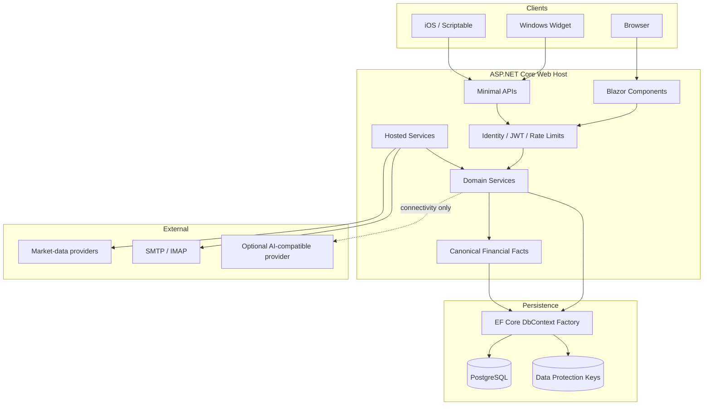

# Architecture case study

## Design goal

AppLifePlanner joins financial truth and personal execution without turning either side into a shallow dashboard. The core design rule is that planning can consume finance, but it cannot invent a competing ledger or projection formula.

## Runtime topology

## Key boundaries

### Web and shared contracts

The Web project owns composition, persistence, routes, integrations, and UI. The Shared project contains entities and transport contracts without taking a dependency on Web infrastructure.

### Financial facts

`FinancialFactsService` is the planning-facing read model. It derives net worth, reserves, contributions, allocation performance, and annual projections from accounts, transactions, allocations, histories, and pricing services.

### Planning

Advanced planning uses pillars, objectives, key results, quarter plans, reviews, habits, and risks. The compact experience adds annual plans, routines, weekly focus, snapshots, and deterministic action cards while preserving those advanced routes.

### Ownership and demo isolation

Identity claims select the effective owner. Global query filters protect tenant data, and the unauthenticated `__DEMO__` tenant is read-only at the persistence layer. Background services create scopes and must explicitly preserve owner boundaries.

### Companion clients

Widgets pair through short-lived codes and retain only a hashed/revocable device token. They consume narrow Today/routine snapshots and never connect directly to PostgreSQL.

## Failure strategy

- Provider failures preserve the last successful quote and expose diagnostics.
- Optional integrations cannot block Today, Routine, Plan, or financial reads.
- Startup migration failure is logged so the process can expose an operational diagnosis.
- Sensitive values are encrypted at rest and never written to structured logs.

## Trade-offs

- Blazor Server provides a cohesive full-stack model but makes circuit lifetime and scoped state explicit design concerns.
- A single Web host keeps deployment affordable, while hosted jobs must be disciplined about scopes and failure isolation.
- Deterministic planning recommendations are less conversational than generative AI, but remain explainable, local, and free to operate.

